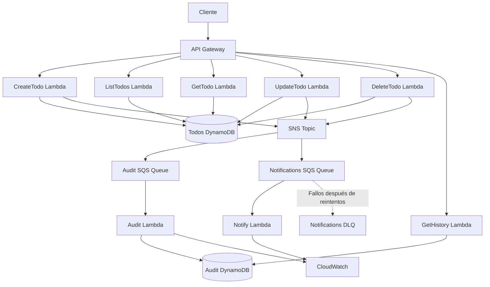

# AWS SAM - CRUD de TODOs (Workshop Parte 2)

Proyecto serverless desarrollado con AWS SAM y Python 3.13. Implementa una API REST para gestionar tareas (TODOs), almacenar su historial de eventos y enviar notificaciones cuando una tarea se completa.

## Arquitectura

La aplicación utiliza los siguientes servicios de AWS:

- **Amazon API Gateway:** expone los endpoints REST.
- **AWS Lambda:** ejecuta las operaciones CRUD y procesa eventos.
- **Amazon DynamoDB:** almacena los TODOs y su historial de auditoría.
- **Amazon SNS:** publica eventos relacionados con los TODOs.
- **Amazon SQS:** recibe y distribuye los eventos.
- **Amazon SQS Dead Letter Queue (DLQ):** almacena mensajes que no pudieron procesarse después de los reintentos.
- **Amazon CloudWatch:** permite consultar los logs de las funciones Lambda.
- **AWS SAM:** define y despliega la infraestructura como código.

### Diagrama de arquitectura



## Funcionalidades

### 1. API REST CRUD

Permite crear, consultar, listar, actualizar y eliminar tareas.

| Método | Ruta | Descripción |
|---|---|---|
| POST | `/todos` | Crear un TODO |
| GET | `/todos` | Listar todos los TODOs |
| GET | `/todos/{id}` | Consultar un TODO |
| PUT | `/todos/{id}` | Actualizar un TODO |
| DELETE | `/todos/{id}` | Eliminar un TODO |
| GET | `/todos/{id}/history` | Consultar el historial de eventos |

### 2. Publicación de eventos con SNS

Las operaciones de creación, actualización y eliminación publican eventos en un SNS Topic.

Los tipos de eventos implementados son:

- `todo.created`
- `todo.updated`
- `todo.completed`
- `todo.deleted`

### 3. Auditoría con SQS y DynamoDB

Los eventos publicados por SNS se envían a una cola SQS de auditoría.

La función `AuditFunction` procesa los mensajes y almacena los registros en `AuditTable`.

Cada registro conserva información como:

- ID del TODO.
- ID único del evento.
- Tipo de evento.
- Fecha y hora.
- Datos del TODO en el momento del evento.

El endpoint `GET /todos/{id}/history` permite consultar estos registros.

### 4. Notificaciones y filtros SNS

La cola de notificaciones recibe únicamente los eventos que cumplen la política de filtrado:

```yaml
FilterPolicy:
  eventType:
    - todo.completed
```

La función `NotifyFunction` procesa las notificaciones de tareas completadas.

### 5. Reintentos y Dead Letter Queue

Se implementó una Dead Letter Queue (DLQ) para almacenar mensajes que no pueden procesarse correctamente después de los reintentos configurados.

Para probar este comportamiento se utiliza un TODO cuyo título contiene `#fail`, lo que provoca un error intencional en `NotifyFunction`.

También se contempla el redrive para devolver mensajes desde la DLQ a la cola original.

## Tecnologías utilizadas

- Python 3.13
- AWS SAM
- AWS Lambda
- Amazon API Gateway
- Amazon DynamoDB
- Amazon SNS
- Amazon SQS
- Amazon CloudWatch
- AWS CloudFormation
- Git y GitHub

## Estructura del proyecto

```text
aws-sam-crud-todos/
├── template.yaml
├── template-parte1-backup.yaml
├── samconfig.toml
├── README.md
├── src/
│   ├── requirements.txt
│   ├── utils.py
│   ├── create_todo.py
│   ├── list_todos.py
│   ├── get_todo.py
│   ├── update_todo.py
│   ├── delete_todo.py
│   ├── get_history.py
│   ├── audit_consumer.py
│   └── notify_consumer.py
└── evidencias/
```

## Despliegue

### Requisitos

- AWS CLI configurado.
- AWS SAM CLI instalado.
- Credenciales de AWS con permisos suficientes.

Validar la plantilla:

```bash
sam validate --lint
```

Construir el proyecto:

```bash
sam build
```

Desplegar la aplicación:

```bash
sam deploy
```

Consultar las salidas del stack:

```bash
sam list stack-outputs --stack-name todo-sam-Jesus
```

## Pruebas realizadas

| Prueba | Resultado esperado |
|---|---|
| Crear TODO | 201 |
| Listar TODOs | 200 |
| Consultar TODO | 200 |
| Actualizar TODO | 200 |
| Eliminar TODO | 204 |
| Consultar historial | 200 |
| Registrar evento `todo.created` | Guardado en AuditTable |
| Registrar evento `todo.updated` | Guardado en AuditTable |
| Registrar evento `todo.completed` | Guardado en AuditTable |
| Filtro SNS | Solo recibe `todo.completed` |
| Procesamiento de notificaciones | Correcto |
| Simulación de fallos con `#fail` | Reintentos y DLQ |
| Redrive de mensajes | Comprobación de recuperación |

## ¿Qué aprendí?

Durante este workshop aprendí a desarrollar y desplegar una arquitectura serverless utilizando AWS SAM.

También aprendí a:

- Construir una API REST utilizando API Gateway y Lambda.
- Administrar información mediante DynamoDB.
- Definir infraestructura como código con AWS SAM y CloudFormation.
- Publicar y distribuir eventos mediante SNS y SQS.
- Implementar filtros de suscripción para procesar eventos específicos.
- Registrar eventos y consultar historiales de auditoría.
- Gestionar errores mediante reintentos y Dead Letter Queues.
- Consultar logs y diagnosticar problemas utilizando CloudWatch.
- Validar, construir y desplegar aplicaciones con AWS SAM.
- Versionar y publicar cambios utilizando Git y GitHub.

## Evidencias

Las capturas de pantalla de las pruebas, el despliegue, los logs de Lambda, el historial de auditoría y el funcionamiento de la DLQ se pueden consultar en la carpeta `evidencias/`.

## Autor

Proyecto académico desarrollado como parte de un workshop de arquitectura serverless con AWS.
